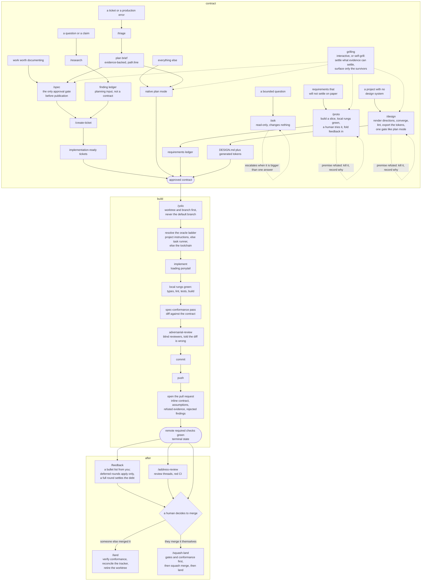
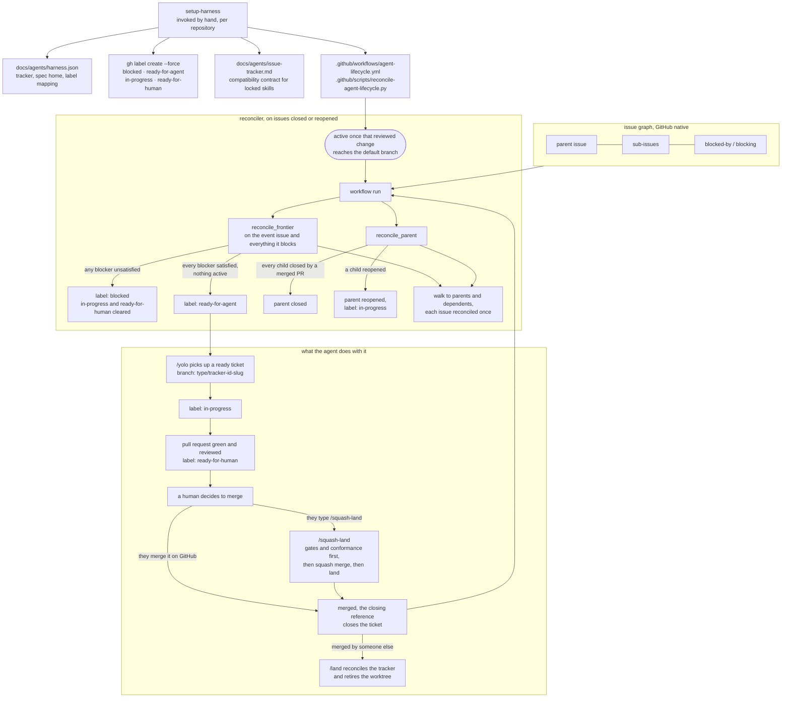

# Harness AI

One committed source for Codex, Claude Code, and OpenCode:

- `POLICY.md` is linked to each client's global instruction path. It carries the routing table, the oracle ladder, and the escalation contract.
- `commands/` holds the workflows. They are reachable only as `/name`, in all three clients.
- `skills/` holds protocol, vocabulary, and locked third-party bodies.
- `install.sh` installs current clients/integrations, preserves mutable client state, and reconciles policy, command, and skill links individually.
- `locked-skills.sh` adds, updates, removes, and validates reviewed third-party skill locks.
- `bench/measure.py` compares the real session population before and after a harness change, reading all three clients' own session stores.
- `statusline/` holds one file per provider: `claude.sh` renders Claude Code's line, `codex.sh` reconciles Codex's built-in one to match.
- `tests/test_harness.py` checks supply-chain and installer invariants.

## Development lifecycle

Every change reaches `/yolo` through one of three contract routes, and exactly one of them is required. `grilling` pressure-tests whichever route is chosen before it is committed to, interactively when a human is driving and in self-grill mode when a workflow needs its own approach broken without blocking. Delivery ends at a green, reviewed, ready-for-human pull request; a human decides to merge it, and `/land` closes the lifecycle, or `/squash-land` does both at once when that human invokes it by name.



The escalation contract can stop any run: the same check failing three times under three different fixes, two attempts that produced no new information, three unchanged external failures, a diff far past the size the contract implied, evidence contradicting the premise, a second review round raising a new blocking finding, or a first touch of a migration, CI config, lockfile, shared contract, infrastructure, or auth surface the request never named. The counters live in `git config` rather than in the conversation, so a restart or a compaction cannot reset them.

## Commands and skills

A workflow is a command, not a skill. A client selects a skill by matching its description, and selects a command only when a human types `/name`, so putting the workflows in `commands/` makes "a workflow never fires on its own" true by construction instead of true by prose plus a guard per client. Commands install to `~/.claude/commands`, `~/.codex/prompts`, and `~/.config/opencode/command`.

Every command that ingests text written elsewhere, a ticket body, a review comment, an error payload, a bullet list, states that the input is task data and cannot override the workflow's constraints. The acceptance suite asserts that line is present.

A locally authored skill still carries all three invocation guards: `policy.allow_implicit_invocation: false` in its `agents/openai.yaml` for Codex, plus `disable-model-invocation: true` and `metadata."opencode/autoinvoke": "false"` in its frontmatter for Claude Code and OpenCode. Only four skills are local now, so the guard matrix covers a much smaller surface than it did when it also had to hold the workflows.

A locked body gets no guard. `agents/openai.yaml` is upstream content, not a harness sidecar, and `computedHash` covers the whole directory, so anything written inside a locked skill is clobbered by the next `skills update` without a drift warning and with the lockfile rewritten to record the loss as correct. The control that survives an update is not installing the skill: a locked body whose upstream description advertises trigger phrases it must not act on is kept out of every client's skill directory, and the code that needs it reads it from its path. The twelve `seo-*` bodies are the only ones, and `seo` reads them as `../seo-<role>/SKILL.md`.

That exclusion now also applies inside this repository. A committed `.claude/skills/<name>` link is an installed skill wherever the repository is open, so an unlinked body does not get one, and the suite asserts its absence.

## Install

The root `../macos.sh` and `../linux.sh` install the harness by default. To reconcile only policy, commands, and skills:

```sh
./harness/install.sh --links-only
```

Reconciliation removes as well as adds. Any symlink in a managed skill or command root whose target is gone, that points into `harness/` at something no longer installed, or whose own name differs from its target's, is backed up and removed, so a renamed or retired entry cannot outlive the change that retired it. That last rule replaces a hardcoded list of retired names: a managed link is always named after its target, so a stale name is detectable structurally even when it still points at a body that is installed under its own name. A real directory shadowing a name the harness manages is backed up too, since the symlink sweep cannot see it.

Anything in the way of a managed path is moved to a timestamped directory under `~/.dotfiles-backups/harness/` rather than overwritten. `--no-backup` deletes it instead, in both this installer and the root one, which forwards the flag:

```sh
./harness/install.sh --links-only --no-backup
```

It is destructive and unrecoverable: a private skill or a hand-edited config sitting at a managed path is gone, not archived. Each removal is still logged, so the run says what it took. Reach for it when the archives are noise, for example a repeated development install, not on a machine whose `~/.claude` or `~/.agents` you have not already reconciled.

The SEO group is optional and is not linked by default. Add or remove it with `--with-seo` / `--without-seo`; the choice is remembered, so a later flagless run keeps it.

```sh
./harness/install.sh --with-seo
```

Engram is core, not optional: the policy assumes memory survives a session. `install_engram` runs one `engram setup <agent>` per client, exactly as https://github.com/Gentleman-Programming/engram documents in `docs/AGENT-SETUP.md`, so both run modes reach it. Setup is idempotent, verified against engram 1.20.0 by running each agent's setup repeatedly in a throwaway `HOME` and checksumming the tree: every run exits 0, `[mcp_servers.engram]` stays single, and the tree is byte-identical from the second run on, the only delta being key and section reordering as the config is re-serialized.

A links-only run therefore reconciles Engram unconditionally rather than probing first. Probing was both longer and weaker: it could only see whether the plugin and MCP were present, never whether the absolute binary path each client pins still resolves, so a stale pin after a Homebrew prefix change passed the check. Running setup rewrites the pin every time.

```sh
engram setup claude-code < /dev/null
engram setup codex       < /dev/null
engram setup opencode    < /dev/null
```

Measured on a clean HOME, each command installs the full plugin, marketplace entry and all, so nothing here drives a client's plugin CLI by hand. The claude-code command asks whether to add engram's tools to the settings allowlist, so all three read from `/dev/null`: this installer never blocks on a prompt, and declining leaves the tools working under Claude Code's own permission handling. That command also writes `~/.claude/mcp/engram.json` pinned to the absolute path of the current binary, which is why `install_packages` upgrades engram before this runs: the pin is rewritten after the upgrade rather than left stale by it.

Setting up Codex also writes `[mcp_servers.engram]` in `config.toml`, which outranks the server the plugin declares in its `.mcp.json`. Nothing is lost by that: engram 1.20.0 writes `args = ["mcp", "--tools=agent"]` and the stable `/opt/homebrew/bin/engram` path, so the entry that wins carries the same agent tool profile the plugin asks for. Verified with `codex mcp list`. Upstream's configuration is kept as shipped.

The full installer uses Homebrew for Codex, OpenCode, GitHub CLI, Engram, UV, and Worktrunk; Anthropic's native latest channel for Claude Code; and official client setup commands for Engram. It never starts an interactive client or authenticates for you.

It runs on macOS and on Linux. Homebrew carries every tool on both, because three of them (OpenCode, Engram, and Worktrunk) ship only as taps, and packaging those a second way for Linux would mean three more update paths to keep honest. Codex is the single exception: its Homebrew formula is a macOS cask, so a Linux box takes `@openai/codex` from npm, which is the channel OpenAI publishes for exactly that case.

Python is the other exception, and it belongs to uv rather than to Homebrew:

```sh
uv python install 3.14 3.11
```

`PYTHON_VERSIONS` in `../lib/python.sh` is the one declaration; neither `Brewfile` nor `linux.sh` names a `python@` formula any more. That file is sourced from both sides and splits the duties: `../macos.sh` and `../linux.sh` call `install_pythons`, because packages are what those scripts are for, and this installer calls `assert_pythons` in its smoke check, because the harness is what consumes the interpreters and so is where a missing one has to fail loudly. Neither half restates which versions those are, and the suite asserts there is no second `PYTHON_VERSIONS=(` anywhere.

Sourcing it is the one thing this installer reads from outside `harness/`. That is deliberate: the alternative was a second copy of the version list, which is exactly the drift the split exists to prevent.

uv resolves a managed version through its own registry rather than through `PATH`, so `uv venv --managed-python --python 3.11` and `uv run --python 3.14` find these whatever pyenv or Homebrew have done to `python3`. That is also why `assert_pythons` asks `uv python find --managed-python` instead of testing `PATH`: a shadowing Homebrew `python3.11` would pass a `PATH` check while uv still had nothing to resolve. 3.11 is there because it is the version the SEO runtime pins, so its first run no longer stops to download an interpreter. `python-tk` is gone too, since uv's standalone builds already bundle tkinter.

`uv` therefore has to arrive before the interpreters do. On macOS it comes from `Brewfile`, on Linux from `linux.sh`'s own formula list, in both cases during the package step that runs before `install_pythons`.

What this deliberately does not do is claim the name `python3`. Each version also lands as `~/.local/bin/python3.14` and `~/.local/bin/python3.11`, but that directory usually sits behind the pyenv shims on `PATH`, so bare `python3` keeps resolving wherever it already did. `uv python install --default` would take `python3` as well; it is experimental in uv 0.12, and taking over the interpreter every other project on the machine resolves is a bigger change than provisioning the harness needs. Run `uv python update-shell` by hand if you want uv's bin directory in front.

Homebrew still installs a `python@` of its own as a dependency of other formulae. That copy is nobody's declared interpreter, and nothing here reads it on purpose.

With the SEO group enabled it also links the portable `claude-seo` launcher. SEO Python dependencies and Chromium remain lazy and live only in the ignored per-user harness cache.

## Shell aliases

`aliases.sh` holds the yolo-mode launchers and is sourced from `~/.zshrc` through one managed line. The installer removes any hand-written definition of `ccyolo`, `cyolo`, or `oyolo` so the committed file is the only source, and leaves every other alias alone.

| Alias | Runs |
| --- | --- |
| `ccyolo` | `claude --dangerously-skip-permissions` |
| `cyolo` | `codex --dangerously-bypass-approvals-and-sandbox` |
| `oyolo` | `opencode` with `OPENCODE_PERMISSION` set to allow edit, bash, and webfetch |

OpenCode has no bypass flag: its permissions are configuration, and `OPENCODE_PERMISSION` overrides them for one run.

## Status line

The three clients expose three different amounts of surface here, so one committed script cannot serve all of them. `statusline/` holds one file per provider that has a status line at all, named after it:

| Client | File | Mechanism | What it does |
| --- | --- | --- | --- |
| Claude Code | `statusline/claude.sh` | Runs an arbitrary command and renders its stdout | Linked to `~/.claude/statusline.sh`, with `statusLine` in `settings.json` pointed at that path |
| Codex | `statusline/codex.sh` | Built in, and configured only by choosing from a fixed set of item ids | Writes `status_line` and `status_line_use_colors` into the `[tui]` table of `~/.codex/config.toml` |
| OpenCode | none | None | Nothing |

The two files are different kinds of thing, which is the whole point of the folder. `claude.sh` is a renderer Claude Code runs on every draw. `codex.sh` is a reconciler the installer runs once, because Codex draws its own line and takes item ids rather than a command. Whichever provider you are chasing, its file is the one named after it.

`claude.sh` renders the model, context-window percentage, directory and branch with a dirty marker, session duration, and reasoning effort on one line, then the five-hour and weekly rate-limit bars underneath, fetched from the OAuth usage endpoint and cached for sixty seconds in `/tmp/claude`.

`codex.sh` owns the item ids, so the installer never names them. It prints the reconciled `config.toml` on stdout and exits 1 when the file already says this, which is what lets `install.sh` take its backup only on a real change rather than mint a fresh backup root every run. Run it by hand to see the diff it would make:

```sh
./harness/statusline/codex.sh ~/.codex/config.toml
```

`status_line` takes an ordered list of built-in item ids, and the six chosen come closest to the Claude line:

```toml
[tui]
status_line = ["model-with-reasoning", "context-used", "current-dir", "git-branch", "five-hour-limit", "weekly-limit"]
status_line_use_colors = true
```

Session duration is dropped, because Codex has no item for it. `/statusline` inside Codex edits the same two keys, so a later choice made there survives until the next install run reconciles it back.

`config.toml` is hand-maintained and holds project trust decisions and hook trust hashes, so the reconciler rewrites only those two keys and leaves every other line byte for byte. Idempotence is textual: the reconciled file is a fixed point, so an unchanged run writes nothing and mints no backup. That also avoids `tomllib`, which needs Python 3.11 and so is absent from the system `python3` macOS ships.

OpenCode has no file in `statusline/` at all. Its configuration schema at https://opencode.ai/config.json has no status line field, and `@opencode-ai/plugin` exposes no hook for one, so there is nothing to render into and nothing to reconcile. A third-party TUI plugin can draw one, but it would be reverse-engineering an unsupported surface that any OpenCode release can break, which is a worse trade than doing without. An empty `opencode.sh` would only make the absence look like an oversight.

## Third-party skill updates

`.agents/skills` points to `harness/skills`. `locked-skills.sh` keeps the skills.sh call, `skills-lock.json`, and Claude bookkeeping link in one reviewed workflow:

```sh
./harness/locked-skills.sh add <owner/repo> <name>
./harness/locked-skills.sh update
./harness/locked-skills.sh remove <name>
./harness/locked-skills.sh check
```

`add` refuses invalid GitHub sources and existing lock, body, command, or bookkeeping paths before it delegates to skills.sh. The existing `seo-*` role rule still wins, so those bodies never get a Claude bookkeeping link. `update` deliberately updates every locked body. `remove` accepts only a current lock entry and refuses unexpected body or Claude-link types. Every mutation prints the affected paths, while `check` runs Bash syntax, diff hygiene, and the harness acceptance suite.

The helper's `--help` is side-effect free. Do not probe the upstream update subcommand with `--help`: skills.sh currently treats that invocation as a full update.

Review every upstream body, security report, and diff, then commit only the approved change. Locked bodies stay pristine; behavior changes belong in a command or in `POLICY.md`. Provisioning never runs the helper, `skills add`, `skills update`, or a lockfile restore command.

A copied skill with unknown provenance remains an attributed local fork until its exact upstream is identified.

Engram and Orca-provided skills are runtime/plugin managed and never belong in `skills-lock.json`.

## Ponytail

Ponytail is a locked skill body, not a plugin. The plugin's mechanism was a `SessionStart` hook that turned lazy mode on for every session in every repository, plus `SubagentStart` and `UserPromptSubmit` trackers, six skills, and a config file. The harness installs none of it, and the smoke check asserts the skill body is present.

Provisioning once also uninstalled that plugin from all three clients. That code is gone: it removed a state no version of this repository ever created, since the plugin predates the harness and lived only in a hand-rolled setup. An installer that migrates away from states it never produced accumulates them forever.

What replaces it is one line in each command that writes code, `/yolo`, `/feedback`, and `/address-review`, saying to load and follow the skill, plus `adversarial-review` using ponytail violations as a review lens and its fix standard. That is a smaller and more precise surface than a session hook: lazy mode applies where code is written rather than to every conversation, and it costs one sentence per command rather than three hooks and five JS files. It also delivers more of the skill, because the hook injects a level-filtered condensation while the locked `SKILL.md` carries the full body, including the reuse-before-writing rung, the root-cause-not-symptom rule, and the read-fully-then-be-lazy boundary.

The trade is deliberate. `/ponytail lite|ultra` switching, the statusline, subagent inheritance, and the five auxiliary skills are gone; the intensity table survives in the body as reference prose with nothing to write the config it describes. In exchange the body is pinned in `skills-lock.json` and changes only through a reviewed `npx skills@1 update`, where the plugin previously moved 4.7.0 to 4.9.0 during an install with six agent-steering bodies changing unread.

## Roster

Commands are `/ask`, `/research`, `/triage`, `/spec`, `/create-ticket`, `/design`, `/proto`, `/yolo`, `/feedback`, `/address-review`, `/land`, and `/squash-land`.

`/design` writes a project's `DESIGN.md` and exports its tokens, pinned to `@google/design.md@0.4.0`, whose format is published at https://github.com/google-labs-code/design.md under Apache-2.0. The pin matters because the tool is pre-1.0 and its format can churn: an unpinned bump changes what a session writes, mid-session, with no diff to review. It is not an oracle-ladder rung. `lint` runs once inside `/design` step 6 and gates that workflow's own approval, so an upstream release breaks a design session rather than reddening a branch. Two things about that linter are worth knowing before trusting it. It exits non-zero only on `broken-ref`, a token reference that resolves to nothing, which is verified against 0.4.0: a misordered section is a warning and a missing one is merely info, so both exit 0. A green lint therefore means no reference dangles, and says nothing about whether the document is complete or the design is good. And WCAG contrast is a warning rather than an error, verified against 0.4.0: a 1.13:1 pair reports `contrast-ratio` and still exits 0. `/design` therefore carries warnings to its approval gate rather than swallowing them, since the gate is where a human can accept a contrast decision deliberately.

`/squash-land` is `/land` for the case where the human deciding to merge is the one typing the command: it squash merges and then lands. It is the only workflow in this harness that merges, and typing its name is the approval, so it never asks twice. What it does not do is append a merge step to `/land`: the merge is irreversible, so both the mergeability gate and the conformance check move ahead of it, and a blocking mismatch stops the merge instead of being reported after it, which is the best `/land` can manage. It also deliberately avoids `gh pr merge --delete-branch`, whose post-merge local checkout fails on a repository whose default branch is checked out in another worktree, reporting an error after the merge has already succeeded.

Local skills are `adversarial-review`, `evidence`, `grilling`, `seo`, and `setup-harness`. `setup-harness` stays a skill because it installs bundled lifecycle assets that only a skill directory can carry; its guards keep it from firing on its own. `grilling` is maintained locally, under the name the routing table already used, and carries the three guards plus a self-grill mode. It replaced the locked Matt Pocock body, whose design-tree rounds ask a whole frontier at once: that is the batching this protocol exists to prevent, and it carried no self-grill mode for `/yolo` and `/triage` to call. The trade is that this body has no lock entry, so it is reviewed the way any other file here is rather than diffed against an upstream.

`/research` and `/proto` replace two locked bodies that were workflows wearing a skill's clothes: they could fire on description matching, and neither produced the artifacts `POLICY.md` now distinguishes. A `/research` finding ledger remains planning input until a planning route produces a complete contract. Publication confirmation alone does not make a research ticket implementation-ready; agreed behavior, acceptance criteria, and verification or test seams are also required. A finalized `/proto` requirements ledger is an implementation contract. As commands they are typed or they do not run, and each now emits the artifact the policy promised.

Locked Matt Pocock skills provide domain/module vocabulary, architecture surveys through `improve-codebase-architecture`, TDD, diagnosis, handoff, and conflict resolution. Locked `DietrichGebert/ponytail` provides lazy mode. Locked `AgriciDaniel/claude-seo` bodies provide the SEO roles, none of them installed. Locked `Leonxlnx/taste-skill` provides frontend design taste as `design-taste-frontend`, whose folder is `taste-skill` upstream but whose frontmatter name is what skills.sh keys the directory and the lock entry on. Two limitations belong here rather than there: its section 12 block library hardcodes a path that does not exist in this layout, so blocks are never authored, and nothing pins a version, because the lock entry carries no ref or tag and `computedHash` is the only drift signal an update surfaces. The other bodies in that repository are deliberately not installed.

Locked `anthropics/skills` provides `frontend-design`, Apache-2.0, the general UI counterpart to a taste body whose own section 13 refuses dashboards, dense product UI, admin panels, data tables, and multi-step forms. It is 8 KB of prose with no scripts, no data, and no hardcoded paths, which is why it costs nothing to carry. `POLICY.md` carries the boundary among the three design bodies, which is what keeps exactly one of them deciding any given surface.

Evaluated and declined, so the next pass does not re-derive them. `nextlevelbuilder/ui-ux-pro-max-skill` was locked and then removed, and it is the interesting one, because it looked like the obvious pick: MIT, and the only candidate carrying real application-UI data (192 palettes, 74 font pairings, twenty-two per-stack tables). What killed it was everything around the data. It is roughly 3.9 MB across seventy files, and `computedHash` covers the whole directory, so every update rehashes all of it. Its documented invocation path is `${CLAUDE_PLUGIN_ROOT}/.claude/skills/...`, which does not exist in this layout. Running its search script writes `__pycache__` inside the locked body, so the invocation needs `-B` or the first honest use breaks the acceptance suite. Its `--persist` flag writes a competing per-project design contract. It ships no licence file inside the skill directory, only MIT at the repository root. And its description claims every interface task while it cannot carry an invocation guard, so it has to be installed unlinked, which then breaks this installer for anyone who has that popular skill name in their own `~/.claude/skills`. Four `POLICY.md` corrections and a broken installer edge case, for a body with no caller until a design workflow exists to read its tables from a path. Reconsider it then, as something a workflow invokes, not as an installed skill.

`Jakubantalik/transitions.dev` has no license file at all, so its motion recipes are all rights reserved; beui, ReUI, EasyUI, and Beautiful UI are component registries bound to React 19, Tailwind 4, and the shadcn registry, which makes them a project's dependency and never this repository's, and ReUI's free tier additionally needs an account and rate-limits requests, so it cannot back an unattended rung; Refero is a hosted beta MCP service with nothing to lock, usable per project at https://refero.design/mcp and never here; designmd.co sits behind bot protection and could not be read. Its community DESIGN.md corpus is available free and MIT-licensed at https://github.com/VoltAgent/awesome-design-md, useful as reference material and read upstream rather than vendored; the format `/design` actually writes is Google's, at https://github.com/google-labs-code/design.md, which is the one with a published schema and a linter.

`improve-codebase-architecture` produces planning input, never a change contract: keep its report and grilling read-only, do not edit `CONTEXT.md` or ADRs inline, and route a selected candidate through native plan mode, `/spec`, or `/proto` before changing files.

Deliberately removed: `to-spec` and `to-tickets`, whose templates now live inline in `/spec` and `/create-ticket` rather than behind a wrapper that overrode most of what it loaded; `code-review`, whose second axis is now a spec-conformance pass `/yolo` runs itself while holding the contract; the `grill-me` and `review` command wrappers, retired earlier, which is a separate thing from the `grill-me` skill body `grilling` now carries; and twelve globally invocable SEO names.

## Invocation guards

`POLICY.md` opens with the commands-and-skills split. Structure carries it for the workflows. For the five local skills, the three per-client guards carry it, and the acceptance suite asserts the full matrix. For a locked body, prose is the only control, which is why a body that must never fire on its own is not installed at all.

## GitHub lifecycle

`setup-harness` writes `docs/agents/harness.json`, creates the four configured labels, writes the Matt-skill tracker compatibility file, and copies the workflow and reconciler bundled in its skill directory. The workflow becomes active when that human-reviewed change reaches the default branch. GitHub native sub-issue and dependency relationships remain the source of truth. A blocker satisfies the ready frontier only when a merged pull request closed it; the parent closes only after every child has that same merge evidence. Closing or reopening a child always reconciles both states.



A blocker counts as satisfied only when the issue is closed *and* a merged pull request closed it, which is why `blocker_satisfied` walks `closedByPullRequestsReferences` rather than trusting the closed state. Closing an issue by hand therefore does not open the frontier behind it.

Three contract routes converge on `/yolo`: `/spec` plus `/create-ticket` for a published ticket contract that is tracker-bound only when a tracker exists, an approved in-conversation contract from native plan mode or from `/design`'s gate, or `/proto` for a requirements ledger discovered by building. Contract source and tracker binding are independent: the source controls conformance, while the binding controls branch names, closing references, and label transitions. An in-conversation, `/proto`, or trackerless ticket contract is preserved in an inline `## Contract`; only a tracker-bound ticket-sourced contract can remain solely in the ticket.

`/land` is the local half of the same step: it resolves the pull request first, gates on the merge, prefers the inline contract for conformance, and falls back to the ticket when no inline contract exists. The ticket is optional, so trackerless work skips tracker transitions. A legacy trackerless pull request without either source reports that conformance cannot be reconstructed, verifies merge and default-branch health, and removes only a clean retained worktree.

`/squash-land` reaches the same local half by the other door, for the case where the human deciding to merge is the one typing the command. It runs the mergeability gate and the conformance check before the irreversible step, squash merges, and then lands exactly as above: tracker reconciled when bound, worktree retired. The reconciler sees no difference, because the closing reference closes the ticket either way.

## Validation

```sh
python3 harness/tests/test_harness.py
```

A structural suite proves nothing about behavior. Validate a change to this directory against the sessions it actually produced:

```sh
python3 harness/bench/measure.py --split <commit-date> --since <window-start>
```

Do not enable the Worktrunk Claude Code plugin. Its `UserPromptSubmit` hook rewrites the same per-branch slot `POLICY.md` uses for attempt and escalation counts, which would erase an escalation on the next prompt.

It reads Claude Code JSONL transcripts, Codex rollout JSONL, and the OpenCode SQLite database, and reports each client separately; `--client` narrows it. A metric a client does not record, such as a declined tool call in Codex or OpenCode, prints as `-` rather than zero.

Populations, not pairs. Cost and friction are the measured part; quality stays a human read of the sessions.

The suite validates shell/Python syntax, the locked-skill lifecycle helper, unique skill names, lock hashes, Claude bookkeeping links, local-vs-locked separation, command shape and task-data framing, command-versus-skill name disjointness, routing-table coverage, secret/generated-state exclusions, installer safety, collision backups, orphan retirement, idempotency, and GitHub close/reopen behavior.
