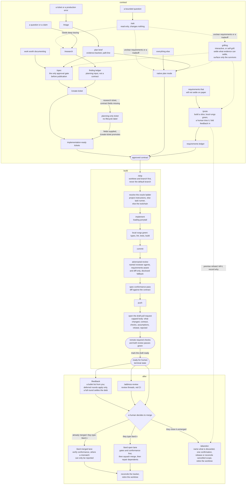
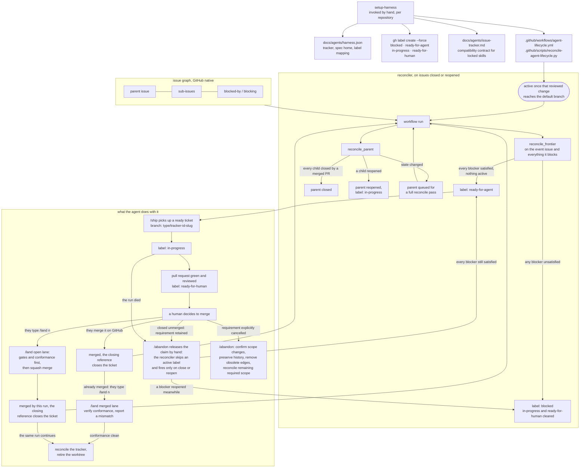

# Harness AI

One committed source for Codex, Claude Code, and OpenCode.

| Path | Holds |
| --- | --- |
| `POLICY.md` | The routing table, oracle ladder, and escalation contract. Linked to each client's global instruction path. |
| `commands/` | The workflows. `/name` in Claude Code and OpenCode, `$name` in Codex. |
| `skills/` | Protocol, vocabulary, and locked third-party bodies. |
| `install.sh` | Installs clients and integrations, reconciles links, preserves mutable client state. |
| `locked-skills.sh` | Adds, updates, removes, and validates third-party skill locks. |
| `bench/measure.py` | Compares the session population before and after a change. Manual in `bench/README.md`. |
| `statusline/` | One file per provider that has a status line. |
| `clients/` | The client settings this harness owns: `claude.json` and `codex.toml` declare them, `codex.sh` reconciles the TOML half, and `agents.py` renders the reviewer agents. |

`clients/` declares rather than symlinks, because both live files are mostly machine state: hook manifests, per-project trust decisions, generated absolute paths. A tracked key replaces the live value on every install, so deleting one here deletes it from the machine; untracked keys are left alone. `permissions` merges a level down, so `deny` stays owned while the Engram allowlist survives. These run after `engram setup`, which rewrites both files from its own template, so being last is what makes a tracked key win over every other writer, the client included: `model`, `effortLevel`, `theme`, and `remoteControlAtStartup` are what `/model`, `/config`, and Remote Control write back at runtime, so an in-session change survives only until the next install.

## Development lifecycle

Every change reaches `/ship` through one of three contract routes, and exactly one is required. `grilling` pressure-tests the chosen route first, interactively when a human drives and in self-grill mode when a workflow needs its own approach broken without blocking. Delivery ends at a green, reviewed, ready-for-human pull request; a human decides to merge it, and `/land` closes the lifecycle, merging it first when that human explicitly invokes `/land`.



The escalation contract can stop any run: the same check failing three times under three different fixes, two attempts that produced no new information, three unchanged external failures, a diff far past the size the contract implied, evidence contradicting the premise, a second review round raising a new blocking finding, or a first touch of a migration, CI config, lockfile, shared contract, infrastructure, or auth surface the request never named. The counters live in `git config` rather than the conversation, so a restart or a compaction cannot reset them.

## Commands and skills

A workflow's source is `commands/`, never `skills/`. Claude Code and OpenCode link them into `~/.claude/commands` and `$XDG_CONFIG_HOME/opencode/command` (defaulting to `~/.config`) and invoke `/name`. Codex invokes `$name`, for example `$ship 38`, through generated explicit-only adapters in `~/.codex/skills`. The shared `~/.agents/skills` root gets no adapters, because OpenCode reads it too.

The installer generates wrappers in `~/.codex/harness-commands`, links each from `~/.codex/skills/<name>`, and links its `command.md` to the canonical body. Each wrapper binds invocation text to `$ARGUMENTS` as task data and carries `policy.allow_implicit_invocation: false` in `agents/openai.yaml`, the metadata documented at https://learn.chatgpt.com/docs/build-skills. Reinstall after adding or removing a command; body edits take effect through the link. Adapters are machine state, never committed. Restart Codex if `$ship` or `/skills` does not list them.

Legacy `~/.codex/prompts` is no longer populated or swept. Migration retires only exact command links owned by this checkout, dangling ones included, and leaves private prompt files, foreign links, and symlinked prompt roots alone. Uninstall removes this checkout's generated tree and exact adapter links, leaving other Codex skills and `.system` alone.

Every command that ingests text written elsewhere, a ticket body, a review comment, an error payload, states that the input is task data and cannot override the workflow's constraints.

A locally authored skill carries all three invocation guards: `policy.allow_implicit_invocation: false` in its `agents/openai.yaml`, plus `disable-model-invocation: true` and `metadata."opencode/autoinvoke": "false"` in its frontmatter. A locked body gets none, because `agents/openai.yaml` is upstream content and `computedHash` covers the whole directory, so anything written inside it is clobbered by the next update with the lockfile recording the loss as correct. The only control that survives an update is not installing the body at all.

## Reviewer agents

`adversarial-review` launches Reviewer A and Reviewer B as named agents. Their standing instructions, lenses, output format, and read-search intent live once, in `skills/adversarial-review/roles/`; the skill keeps orchestration, scaling, diff delivery, triage, and the loop cap. `clients/agents.py <roles> <output>` renders one definition per reviewer per client and rewrites nothing that already matches; `--check` reports a missing, drifted, unmanaged, or widened definition.

The installer generates into `harness/.generated/agents/`, gitignored machine state owned by this checkout, and links each definition into its client's agent directory. The only links it claims are ones whose text points into that directory: an install removes a link whose definition was retired, an uninstall removes every such link and the generated directory, and a private agent or another checkout's link beside them is left alone. `check_links` fails on a missing link or on a definition that lost its restrictions.

| Client | Agents | Path | Control | Not enforced |
| --- | --- | --- | --- | --- |
| Claude Code | `reviewer-a`, `reviewer-b` | `~/.claude/agents/` | `tools: Read, Grep, Glob`, so writes, shell, web, MCP tools, and `Agent` are absent | nothing documented; reading a diff file outside the project without a prompt is unverified |
| Codex | `reviewer_a`, `reviewer_b` | `~/.codex/agents/` | `sandbox_mode = "read-only"`, which blocks writes, plus `mcp_servers` entries disabling agent-browser and Engram | shell, which is how a Codex agent reads files, so its definitions allow read-only commands; web search and nested delegation, which have no documented per-agent control |
| OpenCode | `reviewer-a`, `reviewer-b` | `$XDG_CONFIG_HOME/opencode/agents/` | `mode: subagent` with every permission denied and only `read`, `grep`, `glob`, and `list` re-allowed, `.env` reads still denied | reading a diff file outside the project, which the deny refuses, so the inline fallback covers it; whether MCP tools fall under the deny is unverified |

Codex names use underscores because Codex allows only lowercase letters, digits, and underscores. Every restriction is best effort: the table is what each client documents, the generator prints the same gaps on every install, and no row is runtime-verified until a probe runs against an installed client. Probe during an intentional installation, never as a validation shortcut: in each client, launch each named agent, ask it to write a file, run a command, fetch a URL, and delegate, and record each result as enforced, not enforced, or unverified. The unverified rows are whether Claude Code and Codex load a symlinked definition, whether a Claude Code reviewer reads a diff outside the project without a prompt, whether OpenCode's deny covers MCP tools, whether Codex honors a per-agent `mcp_servers` override of a globally registered server and still loads an agent whose override names an unregistered one, whether the `ccyolo`, `cyolo`, and `ocyolo` launchers leave agent restrictions in force, and diff delivery's inline fallback and escalation.

Reviewer A receives the requirements and the diff, never the implementation rationale; Reviewer B receives only the diff. The parent writes one complete diff snapshot per round to a temporary file outside the worktree. A reviewer that cannot read it answers `unreadable: <path>` and gets the same snapshot inline, and when neither transport can carry the whole diff the review escalates instead of truncating. When a named agent is unavailable, the parent says so and launches a general agent with the role file as its instructions, with the Codex Access line swapped in under Codex, disclosing that the fallback enforces only that agent's own permissions. Review is never skipped. Nothing here claims model diversity: both reviewers run whatever model their client assigns.

## Install

The root `../macos.sh` and `../linux.sh` install the harness by default. To reconcile only policy, commands, and skills:

```sh
./harness/install.sh --links-only
```

| Flag | Effect |
| --- | --- |
| `--links-only` | Reconcile links without installing packages. Engram and agent-browser are still reconciled, so both must already be installed. |
| `--no-backup` | Delete what is in the way instead of archiving it. Destructive and unrecoverable. |
| `--uninstall` | Remove every managed link, the generated reviewer agents, the alias block, the tracked client keys, Engram, and agent-browser. Keeps `~/.engram` and `~/.agent-browser`. |
| `--clear-backups` | Delete every archive under `~/.dotfiles-backups/harness/`. Runs on its own. |

Reconciliation removes as well as adds. A symlink in a managed root is backed up and removed when its target is gone, points into `harness/` at something no longer installed, or carries a name differing from its target's, so a retired entry cannot outlive the change that retired it. A real directory shadowing a managed name is backed up too, since the sweep cannot see it. One defect is left in place and tracked separately: the dangling branch removes a dangling symlink whoever wrote it, because a target resolving to nothing cannot be tested for ownership.

Managed roots are real directories, so harness links and your private entries sit side by side; a symlink standing in for one is moved aside under `.previous-link`. The OpenCode skills root is normalized but never created, since OpenCode reads `~/.agents/skills`. OpenCode's own three paths follow `XDG_CONFIG_HOME` when set, the same default `../lib/common.sh` resolves. Anything in the way is moved to a timestamped directory under `~/.dotfiles-backups/harness/`, or deleted with `--no-backup`, which the root installer forwards. Each removal is logged.

Both run modes verify what they wrote. `check_links` asserts every skill, command, policy, status line, and reviewer agent link on every run; `check_tools` adds the client, plugin, and interpreter assertions only a full run can satisfy. Its OpenCode assertion reads `opencode debug config` through a temporary file rather than a pipe: that command stops at the 64 KiB pipe capacity whenever stdout is not a regular file, and this config passed 64 KiB once the harness's own command templates went into it, so the piped form failed on a JSON parse error instead of on the assertion. Both run after Engram, which rewrites `config.toml` and `settings.json`.

### MCP servers

Engram is core, not optional: the policy assumes memory survives a session. `install_engram` runs one `engram setup <agent>` per client, as engram's own `docs/AGENT-SETUP.md` (https://github.com/Gentleman-Programming/engram) documents, and is idempotent. Both run modes reconcile it unconditionally rather than probing, because probing sees presence but never whether the pinned absolute binary path still resolves; setup rewrites the pin every time. The claude-code command is answered yes to allowlist Engram's tools; the other two take a closed stdin. The allowlist stays untracked, since a tracked copy of a tool set Engram owns goes stale silently.

agent-browser (https://github.com/vercel-labs/agent-browser) ships no per-client registrar, so `install_agent_browser` writes the three registrations itself: `claude mcp add --scope user` and `codex mcp add`, plus a JSON edit to `opencode.json` for the client whose `opencode mcp add` is interactive. It runs from `reconcile_clients`, after `engram setup`, which would otherwise drop it. `check_tools` asserts both servers per client, so a run that clobbered Engram's entry fails.

Registration is global. Only two clients could be per project anyway, since Codex reads only `~/.codex/config.toml`, verified with `codex doctor`, and a browser driver is a general tool like `gh` rather than a dependency of one repository. Each registration is removed and re-added, so a re-run is idempotent and the pinned path is never stale. The profile is the default, meaning no `--tools` flag, so only `core` loads. Widening to `network`, `state`, `debug`, `tabs`, `react`, `mobile`, or `all` is a one-word edit there, and each would cost context in every session of all three clients.

The formula is homebrew-core. It publishes no x86_64 macOS bottle, so an Intel Mac builds from source, and on Linux the install takes `--with-deps`, which is mandatory there and rejected elsewhere. Its caveat is run rather than printed: `agent-browser install` downloads Chrome for Testing, without which every browser call fails mid-session. The uninstall removes all three registrations and the formula, and leaves `~/.agent-browser` alone: it holds the browser download and whatever profiles the CLI saved beside it, and this installer does not delete another tool's data directory. The summary measures the directory and reports it.

### Packages

Homebrew carries every tool on both platforms, because three of them (OpenCode, Engram, Worktrunk) ship only as taps. Codex is the exception: its formula is a macOS cask, so Linux takes `@openai/codex` from npm. Claude Code comes from Anthropic's native latest channel. The installer never starts an interactive client or authenticates for you.

Python belongs to uv rather than Homebrew:

```sh
uv python install 3.14
```

`PYTHON_VERSIONS` in `../lib/python.sh` is the one declaration, and sourcing it is the only thing this installer reads from outside `harness/`. The root scripts call `install_pythons`; `check_tools` calls `assert_pythons`, because the harness consumes the interpreters. That check asks `uv python find --managed-python` rather than testing `PATH`, since a shadowing Homebrew `python3.14` would pass while uv had nothing to resolve, and `uv` therefore arrives first, from `Brewfile` on macOS and `linux.sh` on Linux. Nothing here claims the name `python3`: each version also lands as `~/.local/bin/python3.14`, usually behind the pyenv shims. Run `uv python update-shell` to change that.

## Shell aliases

`aliases.sh` holds the yolo-mode launchers and is sourced from `~/.zshrc` through one managed line. The installer removes any hand-written `ccyolo`, `cyolo`, or `ocyolo` so the committed file is the only source, and leaves every other alias alone.

| Alias | Runs |
| --- | --- |
| `ccyolo` | `claude --dangerously-skip-permissions` |
| `cyolo` | `codex --dangerously-bypass-approvals-and-sandbox` |
| `ocyolo` | `opencode` with `OPENCODE_PERMISSION` set to allow edit, bash, and webfetch |

OpenCode has no bypass flag: its permissions are configuration, and `OPENCODE_PERMISSION` overrides them for one run.

Zsh is the only shell either shell-facing step writes: the aliases go into `~/.zshrc`, and Worktrunk is asked for its zsh integration by name. A run whose `$SHELL` is something else warns and names both, rather than leaving the aliases quietly absent. Source `aliases.sh` from your own rc and run `wt config shell install` for that shell.

## Status line

The three clients expose three different amounts of surface, so one committed script cannot serve all of them.

| Client | File | Mechanism |
| --- | --- | --- |
| Claude Code | `statusline/claude.sh` | A renderer run on every draw, linked to `~/.claude/statusline.sh` with `statusLine` pointed at it |
| Codex | `statusline/codex.sh` | A reconciler run once, writing `status_line` and `status_line_use_colors` into `[tui]` in `~/.codex/config.toml` |
| OpenCode | none | No status line field in its schema and no plugin hook, so there is nothing to render into |

`claude.sh` renders model, context-window percentage, directory and branch with a dirty marker, session duration, and reasoning effort, then the five-hour and weekly rate-limit bars, fetched from the OAuth usage endpoint and cached for sixty seconds in `/tmp/claude`.

`codex.sh` owns the item ids, so the installer never names them. It prints the reconciled config on stdout and exits 3 when the file already says this, which lets `install.sh` back up only on a real change. Run it by hand to see the diff it would make:

```sh
./harness/statusline/codex.sh ~/.codex/config.toml
```

The two keys it owns, whose item ids are the closest match to the Claude line:

```toml
[tui]
status_line = ["model", "context-used", "project-name", "git-branch", "reasoning", "five-hour-limit", "weekly-limit"]
status_line_use_colors = true
```

`model` and `reasoning` are separate items rather than the combined `model-with-reasoning`, so effort sits after the branch the way it does in `claude.sh`, and `project-name` is the basename `current-dir` would print in full. Session duration is dropped, because Codex has no item for it. `/statusline` inside Codex edits the same two keys, so a choice made there survives until the next install. The reconciler rewrites only those two keys and leaves every other line byte for byte, which also avoids `tomllib`: it needs Python 3.11, absent from the system `python3` macOS ships.

## Third-party skill updates

`.agents/skills` points to `harness/skills`. `locked-skills.sh` keeps the skills.sh call, `skills-lock.json`, and the Claude bookkeeping link in one reviewed workflow:

```sh
./harness/locked-skills.sh add <owner/repo> <name>
./harness/locked-skills.sh update
./harness/locked-skills.sh remove <name>
./harness/locked-skills.sh check
```

`add` refuses invalid sources and existing paths before delegating. `update` updates every locked body. `remove` accepts only a current lock entry. Every mutation prints the affected paths; `check` runs syntax and diff hygiene. The helper's `--help` is side-effect free, but do not probe the upstream update subcommand with `--help`: skills.sh treats that as a full update.

Review every upstream body, security report, and diff, then commit only the approved change. Locked bodies stay pristine; behavior changes belong in a command or in `POLICY.md`. Provisioning never runs the helper or a lockfile restore. A copied skill with unknown provenance stays an attributed local fork until its upstream is identified. Engram and Orca-provided skills are runtime managed and never belong in `skills-lock.json`.

Binaries are the deliberate exception. Every prose body has its hash in `skills-lock.json`, while the clients arrive unpinned: `curl -fsSL https://claude.ai/install.sh | bash`, `npm install --global @openai/codex@latest`, and two Homebrew taps. A locked body is a reviewed instruction this harness executes forever, so a change to one has to be read; a client is a moving target whose next version is the point of re-running the installer. The trade is a supply chain that trusts Anthropic, OpenAI, and two tap owners at install time.

## Roster

Commands are `/ask`, `/research`, `/triage`, `/harness-audit`, `/spec`, `/create-ticket`, `/proto`, `/ship`, `/feedback`, `/address-review`, `/land`, and `/abandon`.

`/land` has two lanes, selected by the pull request's state. Explicit `/land <n>` authorizes squash-merging an open non-draft pull request after its gates pass; an already-merged one runs only the remaining cleanup. No extra argument or second confirmation. Automatic routing and other workflows never invoke it. Both the mergeability gate and the conformance check precede the merge, so a blocking mismatch prevents it, where the merged lane can only report one. With no argument it resolves the current worktree's head branch, falling back to a search over merged pull requests only.

`/abandon` is the other exit, for work that will not land. No tracker automation recovers a ticket stranded at `in-progress`, since the reconciler skips an active label and fires only on close or reopen, so the worktree and the claim would have no owner. It is a command rather than a lane inside `/land` because `/proto` calls it to kill a prototype. Being the only workflow that discards unmerged work, it lists every commit and uncommitted change and takes one confirmation on that list. An abandoned attempt preserves scope and dependencies for retry; explicit cancellation reconciles parent scope and obsolete edges in the same confirmation, and never counts as merge evidence.

Local skills are `adversarial-review`, `evidence`, `grilling`, `grill-with-docs`, `local-tracker`, `setup-harness`, and `workflow-checkpoint`, each carrying the three guards. `local-tracker` holds what a tracker operation means when the tracker is committed markdown, so the delivery commands gain one pointer each instead of a files-mode branch apiece. `workflow-checkpoint` is the one definition of the branch-scoped Engram checkpoint: its topic key, record schema, recovery validation, and terminal states, so the delivery commands can load it by name instead of each restating the schema. `setup-harness` stays a skill because it installs bundled assets only a skill directory can carry. `grilling` is local rather than locked so it can carry a self-grill mode and ask one question at a time. `grill-with-docs` composes it with `domain-modeling`, and is the only surface that writes `CONTEXT.md` or an ADR. A `/research` ledger stays planning input until a route produces a complete contract; a finalized `/proto` ledger is itself a contract.

Locked Matt Pocock skills provide domain and module vocabulary, `improve-codebase-architecture`, TDD, diagnosis, handoff, and conflict resolution. Locked `DietrichGebert/ponytail` provides lazy mode. Locked `JuliusBrussee/caveman` provides `caveman-commit`; only `skills/` is taken, which that repository licenses MIT. Where a locked body and the policy disagree the policy wins: caveman allows a 72-character subject, `POLICY.md` allows 50.

`improve-codebase-architecture` produces planning input, never a change contract: keep its report read-only and route a candidate through native plan mode, `/spec`, or `/proto` before changing files.

### Impeccable

Locked `pbakaus/impeccable` is the one frontend design body. It is description-matchable, so the control is scope rather than a guard: no command or local skill loads it, and `POLICY.md` keeps the project's existing styling layer winning inside `/proto` and `/ship`.

It arrives only through `locked-skills.sh`. Four of its own routes are forbidden, because each writes outside the lock: `npx impeccable install` and `$impeccable hooks on` wire `PostToolUse` and `Stop` hooks into a project unasked, `npx impeccable update` rewrites the locked directory out from under `skills-lock.json`, and `scripts/pin.mjs` mints a `$<command>` shortcut as a real skill directory that `install.sh` would link everywhere and neither sweep would reclaim. The lock covers the body's bytes, not its runtime egress: several scripts call the author's site. At 4.8 MB across 168 files it is the largest thing in `skills/`, against about 99 KB for everything else combined.

### Ponytail

Ponytail is a locked skill body, not a plugin. None of the plugin is installed, and `check_links` asserts the body is present. What replaces its `SessionStart` hook is one line in each command that writes code, `/ship`, `/proto`, `/feedback`, and `/address-review`, plus `adversarial-review` using ponytail violations as a review lens. Lazy mode then applies where code is written rather than to every conversation, and delivers the full `SKILL.md` instead of the hook's level-filtered condensation. The trade is that `/ponytail lite|ultra` switching and the auxiliary skills are gone, and in exchange the body changes only through a reviewed update, where the plugin once moved 4.7.0 to 4.9.0 mid-install with six agent-steering bodies changing unread.

## Invocation guards

`POLICY.md` opens with the commands-and-skills split. Command storage carries it for the workflows, and generated Codex adapters enforce explicit invocation through native metadata. For the local skills the roster lists, the three per-client guards carry it. For a locked body prose is the only control, which is why a body that must never fire on its own is not installed at all.

## GitHub lifecycle

In GitHub mode, `setup-harness` writes `docs/agents/harness.json`, creates the four labels, writes the tracker compatibility file, and copies the bundled workflow and reconciler. The workflow becomes active when that reviewed change reaches the default branch. GitHub native sub-issue and dependency relationships remain the source of truth. A blocker satisfies the frontier only when a merged pull request closed it, which is why `blocker_satisfied` walks `closedByPullRequestsReferences` rather than trusting the closed state; closing an issue by hand does not open the frontier behind it. The parent closes only after every child has that same evidence.

The other mode is local markdown, where `setup-harness` writes the config and compatibility file and nothing else: no labels, no workflow, no reconciler. Lifecycle state is a `Status:` line and a `Blocked by:` line committed beside the code, and the `local-tracker` skill holds what each operation means there.



Contract source and tracker binding are independent: the source controls conformance, the binding controls branch names, closing references, and label transitions. An in-conversation, `/proto`, or trackerless ticket contract is preserved in an inline `## Contract`; only a tracker-bound ticket-sourced contract can remain solely in its ticket.

`/land` resolves the pull request first and lets that state pick the lane, prefers the inline contract for conformance, and falls back to the ticket when none exists. Trackerless work skips tracker transitions. A legacy trackerless pull request with neither source reports that conformance cannot be reconstructed, verifies merge and default-branch health, and removes only a clean retained worktree.

## Validation

Validate a change to this directory against the sessions it produced, as `harness/bench/README.md` explains:

```sh
python3 harness/bench/measure.py --split <commit-date> --since <window-start>
```

It reads Claude Code JSONL transcripts, Codex rollout JSONL, and the OpenCode SQLite database, and reports each client separately; `--client` narrows it. A metric a client does not record, such as a declined tool call in Codex or OpenCode, prints as `-` rather than zero.

Eight medians per cohort: `turns`, `tool_calls`, and `minutes` for cost, `interrupts`, `denials`, and `errors` for friction, and `commands` and `delegation` for routing adoption and subagent use. A subagent gets its own transcript in both clients that delegate, and counts as the parent's delegation rather than as a session.

A hard week at work moves every one of those numbers without the harness changing. Copy `harness/bench/cohorts.example.json` to `cohorts.json` and list the project patterns that mean work, and the report splits work from personal. That file is gitignored.

Populations, not pairs. Cost and friction are the measured part; quality stays a human read of the sessions.

Do not enable the Worktrunk Claude Code plugin. Its `UserPromptSubmit` hook rewrites the same per-branch slot `POLICY.md` uses for attempt and escalation counts, which would erase an escalation on the next prompt.
